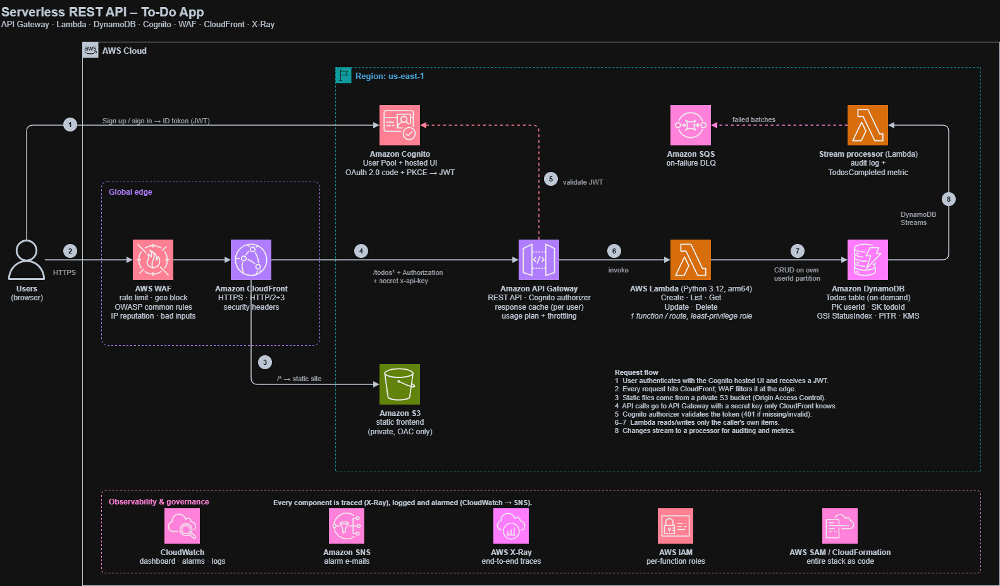

# Serverless REST API with Cognito Auth, DynamoDB & WAF

> **AWS Solutions Architect – Associate · Graduation Project 3**
> Architecture design for a production-style, fully serverless to-do application: a static frontend on
> S3 + CloudFront, a REST API on API Gateway + Lambda, data in DynamoDB, users in Cognito, edge protection
> with AWS WAF, and end-to-end tracing with X-Ray.

| | |
|---|---|
| **Architecture type** | Serverless |
| **Region** | `us-east-1` (required for a CloudFront-scoped WAF web ACL) |
| **Compute** | AWS Lambda, Python 3.12 on Graviton (arm64) |
| **Infrastructure as code** | AWS SAM / CloudFormation (target deployment method) |
| **Author** | [Rayene Knani](https://www.linkedin.com/in/rayene-knani-539620268) |

This repository contains the architecture design and its documentation: the diagram, the service choices,
the data model, the security controls and the API contract.

---

## Table of contents

1. [Architecture](#1-architecture)
2. [AWS services and why each one is used](#2-aws-services-and-why-each-one-is-used)
3. [Key design decisions](#3-key-design-decisions)
4. [Security: defense in depth](#4-security-defense-in-depth)
5. [API design](#5-api-design)
6. [Implementation steps](#6-implementation-steps)
7. [Observability](#7-observability)
8. [Cost estimate](#8-cost-estimate)
9. [Well-Architected Framework mapping](#9-well-architected-framework-mapping)
10. [Learning outcomes](#10-learning-outcomes)
11. [Future improvements](#11-future-improvements)

---

## 1. Architecture



> Editable source: [`docs/architecture.drawio`](docs/architecture.drawio). Open it at [app.diagrams.net](https://app.diagrams.net).

### Request flow

| # | Step |
|---|------|
| 1 | The user signs up / signs in on the **Cognito hosted UI** using the OAuth 2.0 **Authorization Code flow with PKCE** and receives a JWT (ID token). |
| 2 | Every request goes to **CloudFront** over HTTPS. **AWS WAF** inspects it at the edge (rate limiting, geo blocking, OWASP common rules, IP reputation, known bad inputs). |
| 3 | Requests for the website (`/*`) are served from a **private S3 bucket** through **Origin Access Control**. The bucket is never public. |
| 4 | Requests for the API (`/todos*`) are forwarded to **API Gateway** with the user's `Authorization` header, plus a secret `x-api-key` header that only CloudFront knows. |
| 5 | API Gateway's **Cognito authorizer** validates the JWT. Missing or invalid tokens get `401` without ever invoking Lambda. |
| 6 | API Gateway invokes one of five **Lambda** functions (one per route). `GET /todos` responses are served from the **API Gateway cache** when possible. |
| 7 | Lambda reads/writes **DynamoDB**, always inside the caller's own partition (`userId` = Cognito `sub`). |
| 8 | Every item change flows through **DynamoDB Streams** to a processor Lambda that writes an audit log and a custom CloudWatch metric. Failed batches go to an **SQS** dead-letter queue. |

**X-Ray** traces the whole chain (API Gateway → Lambda → DynamoDB). **CloudWatch** collects logs, metrics, a dashboard and alarms, which notify through **SNS**.

---

## 2. AWS services and why each one is used

| Service | Role in this architecture | Why this choice |
|---|---|---|
| **Amazon API Gateway (REST)** | Public API, Cognito JWT authorizer, response caching, usage plan, stage throttling | REST APIs (not HTTP APIs) support caching, usage plans/API keys and native X-Ray integration. |
| **Amazon Cognito User Pool** | Sign-up, sign-in, e-mail verification, hosted UI, JWT tokens | Managed identity with no auth code to maintain; integrates natively with API Gateway authorizers. |
| **AWS Lambda** | Five CRUD handlers + a DynamoDB Streams processor | Pay-per-request, scales to zero, no servers to patch. One function per route = one least-privilege IAM role per route. |
| **Amazon DynamoDB** | `Todos` table with a GSI, on-demand capacity, Streams, PITR, KMS encryption | Single-digit-ms latency, serverless scaling, predictable key-based access patterns. |
| **AWS WAF** | Rate-based rule, geo match, AWS managed rule groups | Blocks abuse and common web exploits before they reach (and cost) the backend. |
| **Amazon CloudFront** | Single HTTPS entry point for the site and the API; security headers; edge caching for static files | Global low-latency edge, TLS everywhere, one domain (no CORS needed), WAF attachment point. |
| **Amazon S3** | Hosts the static frontend | Durable, cheap static hosting; kept private behind CloudFront OAC. |
| **AWS X-Ray** | Distributed tracing | Pinpoints latency and errors across API Gateway, Lambda and DynamoDB. |
| **Amazon CloudWatch** | Logs (14-day retention), metrics, dashboard, alarms | Central operational visibility. |
| **Amazon SNS** | Alarm notifications by e-mail | Decoupled fan-out for alerts. |
| **Amazon SQS** | On-failure destination for the stream processor | Failed stream records are kept for 14 days instead of being lost. |
| **AWS IAM** | Per-function execution roles | Each function can call only the one or two DynamoDB actions it needs, on one table. |
| **AWS SAM / CloudFormation** | Entire stack as code | Repeatable deploys, one-command teardown, reviewable infrastructure. |

---

## 3. Key design decisions

### 3.1 DynamoDB data model

| Attribute | Key | Example | Purpose |
|---|---|---|---|
| `userId` | **Partition key** | `8f1c…` (Cognito `sub`) | Every user's items live in their own partition, so tenant isolation comes from the key, not from filtering. |
| `todoId` | **Sort key** | UUID v4 | Unique per item. |
| `title` | – | `Buy milk` | 1–200 characters, validated in Lambda. |
| `status` | – | `pending` / `done` | |
| `createdAt`, `updatedAt` | – | ISO-8601 | |
| `statusCreatedAt` | **GSI sort key** | `pending#2026-10-25T10:00:00.000Z` | Composite key for the `StatusIndex` GSI. |

**Access patterns**

| Pattern | Operation |
|---|---|
| List all my to-dos | `Query` table where `userId = :me` |
| List my to-dos by status, newest first | `Query` **GSI `StatusIndex`** where `userId = :me AND begins_with(statusCreatedAt, "done#")` |
| Get / update / delete one to-do | `GetItem` / `UpdateItem` / `DeleteItem` on `(userId, todoId)` with `attribute_exists` conditions (returns `404` instead of silently creating items) |

No `Scan` is ever used. Capacity is **on-demand** because traffic is unpredictable and low; provisioned capacity with auto scaling would make sense at steady, high volume.

### 3.2 Caching at two layers

* **CloudFront** caches the static frontend.
* **API Gateway cache** (0.5 GB) caches `GET /todos` for 10 seconds to cut Lambda invocations and DynamoDB reads.
  The cache key includes the **`Authorization` header and the `status` query string**, so one user can never receive another user's cached list. This is the most important detail when caching an authenticated API.
* API responses carry `Cache-Control: private, no-store`, so CloudFront and browsers don't store per-user data.

### 3.3 Why CloudFront in front of API Gateway?

* One domain for site + API → no CORS configuration, and the Cognito callback URL is the same origin.
* WAF is attached at the edge (CloudFront scope), so it sees real client IPs and blocks attacks closest to the source.
* API Gateway uses a **Regional** endpoint, because CloudFront already provides the edge layer.
* **Origin protection:** CloudFront adds a secret `x-api-key` header. API Gateway requires that key on every method, so calls that bypass CloudFront (and therefore bypass WAF) are rejected. The same key ties traffic to a **usage plan** (throttle 50 rps / burst 100, quota 20,000 requests/day).

### 3.4 DynamoDB Streams for downstream processing

The stream processor follows the event-driven pattern without coupling it to the API: the CRUD functions don't know it exists. It logs a structured audit record for every `INSERT` / `MODIFY` / `REMOVE` and publishes a business metric (`ServerlessTodo/TodosCompleted`) using the CloudWatch **Embedded Metric Format**, which needs no extra API calls. Retries are limited, poison batches are bisected, and failures land in an SQS queue.

---

## 4. Security: defense in depth

| Layer | Control |
|---|---|
| **Edge** | WAF: per-IP rate limit (300 requests / 5 min), geo block list, `AWSManagedRulesCommonRuleSet` (OWASP Top 10 style: XSS, LFI, bad bots, size limits), `AmazonIpReputationList`, `KnownBadInputsRuleSet` (e.g. Log4Shell). HTTPS only, TLS 1.2+ to origins, HTTP security headers (HSTS, X-Frame-Options, X-Content-Type-Options, Referrer-Policy). |
| **Origin** | S3 bucket fully private (Block Public Access + OAC, bucket policy limited to this distribution, TLS-only). API Gateway requires the CloudFront-only API key. |
| **Identity** | Cognito User Pool with strong password policy, e-mail verification, user-existence-error prevention. OAuth 2.0 Authorization Code + **PKCE** (no client secret in the browser, no tokens in URLs). Short-lived tokens (60 min ID/access, 1-day refresh). |
| **API** | Cognito authorizer on every route, stage throttling, usage-plan quota, request validation in Lambda (JSON shape, title length, allowed status values). |
| **Compute** | One IAM role per function with only the actions it needs (e.g. `CreateTodo` → `dynamodb:PutItem` on one table ARN). No credentials in code. |
| **Data** | Tenant isolation by partition key, conditional writes, encryption at rest with KMS (DynamoDB), SSE-S3 (bucket), SSE-SQS (queue), point-in-time recovery for the table. |
| **Detection** | CloudWatch alarms on API 5XX, Lambda errors and WAF block spikes → SNS e-mail. X-Ray traces for investigation. |

### Expected behavior of the security controls

| Request | Result |
|---|---|
| Frontend via CloudFront | `200` |
| S3 bucket accessed directly | `403` (private bucket) |
| API call without a token | `401` (Cognito authorizer) |
| API call with a forged token | `401` |
| XSS payload in the query string | `403` (WAF common rule set) |
| Direct API Gateway call bypassing CloudFront | `401` / `403` (no token, or valid token but missing API key) |
| More than 300 requests in 5 min from one IP | `403` (WAF rate-based rule) |

---

## 5. API design

Base URL: `https://<cloudfront-domain>` · All routes require `Authorization: <Cognito ID token>`.

| Method | Path | Body | Success | Errors |
|---|---|---|---|---|
| `POST` | `/todos` | `{"title": "Buy milk"}` | `201` + item | `400` invalid body, `401` |
| `GET` | `/todos` | – | `200` `{"items": [...], "count": n}` | `401` |
| `GET` | `/todos?status=pending\|done` | – | `200` (served via GSI) | `400` bad status, `401` |
| `GET` | `/todos/{todoId}` | – | `200` + item | `404`, `401` |
| `PUT` | `/todos/{todoId}` | `{"title": "...", "status": "done"}` (either or both) | `200` + updated item | `400`, `404`, `401` |
| `DELETE` | `/todos/{todoId}` | – | `204` | `404`, `401` |

| Lambda function | Route | IAM permissions |
|---|---|---|
| `CreateTodo` | `POST /todos` | `dynamodb:PutItem` |
| `ListTodos` | `GET /todos` | `dynamodb:Query` (table + `StatusIndex`) |
| `GetTodo` | `GET /todos/{todoId}` | `dynamodb:GetItem` |
| `UpdateTodo` | `PUT /todos/{todoId}` | `dynamodb:GetItem`, `dynamodb:UpdateItem` |
| `DeleteTodo` | `DELETE /todos/{todoId}` | `dynamodb:DeleteItem` |
| `StreamProcessor` | DynamoDB Streams trigger | stream read + `sqs:SendMessage` to the DLQ |

Example item:

```json
{
  "todoId": "3b0c2a7e-5f7d-4a4e-9a1f-6f0f2c1d9b11",
  "title": "Review architecture diagram",
  "status": "pending",
  "createdAt": "2026-10-25T10:12:44.120Z",
  "updatedAt": "2026-10-25T10:12:44.120Z"
}
```

---

## 6. Implementation steps

The build order, in the console or as one AWS SAM template:

1. **DynamoDB** – create the `Todos` table (PK `userId`, SK `todoId`, on-demand), the `StatusIndex` GSI, Streams (new and old images), PITR and KMS encryption.
2. **Cognito** – create a User Pool (e-mail sign-in, password policy, e-mail verification), a hosted UI domain, and a public app client using the Authorization Code grant with PKCE.
3. **Lambda** – create the five CRUD functions and the stream processor, each with its own least-privilege role, X-Ray active tracing and a 14-day log retention.
4. **API Gateway** – create a Regional REST API with the routes above, the Cognito authorizer, API-key requirement, a usage plan, stage throttling, and a 0.5 GB cache on `GET /todos` keyed on `Authorization` + `status`.
5. **WAF** – create a CloudFront-scoped web ACL with the five rules listed in §4.
6. **S3 + CloudFront** – private bucket for the frontend, one distribution with two origins (S3 via OAC for `/*`, API Gateway for `/todos*`), the secret `x-api-key` origin header, and the WAF web ACL attached.
7. **Monitoring** – SNS topic, CloudWatch alarms and dashboard.
8. **Teardown** – delete the stack (after emptying the bucket) so the hourly-billed cache and WAF stop charging.

---

## 7. Observability

* **X-Ray service map:** Client → API Gateway → Lambda → DynamoDB, with per-segment latency. Cached `GET /todos` requests never reach Lambda, which is visible in the traces.
* **CloudWatch dashboard:** API requests / 4XX / 5XX, p90 latency vs integration latency, cache hits vs misses, Lambda invocations / errors, WAF allowed vs blocked, DynamoDB consumed capacity, and the `TodosCompleted` business metric.
* **Alarms → SNS:** API 5XX ≥ 5 in 5 min · CRUD Lambda errors ≥ 3 in 5 min · WAF blocked requests ≥ 100 in 5 min.
* **Logs:** one log group per function with 14-day retention; the stream processor writes structured JSON audit records that can be queried with CloudWatch Logs Insights:

```
fields @timestamp, event, todoId, oldStatus, newStatus
| filter type = "audit"
| sort @timestamp desc
```

---

## 8. Cost estimate

Approximate `us-east-1` on-demand prices for a small demo; check the AWS pricing pages for current numbers.

| Component | Pricing basis | Cost |
|---|---|---|
| Lambda, API Gateway requests, DynamoDB on-demand, Cognito (< 10k MAU), S3, CloudFront, X-Ray, SQS, SNS | Per request / per GB | ≈ $0 at demo scale (free usage tiers) |
| **API Gateway cache** (0.5 GB) | ≈ $0.02 per hour | ≈ $0.48 / day |
| **AWS WAF** | $5 / web ACL / month + $1 / rule / month (5 rules) + requests | ≈ $0.33 / day |
| CloudWatch dashboard + 3 alarms | Dashboard ≈ $3 / month beyond the free 3 | ≈ $0.10 / day |
| **Total while deployed** | | **≈ $1 / day** |

The only fixed hourly costs are the API cache and WAF; everything else scales with usage and is effectively free when idle. Disabling the API cache roughly halves the running cost.

---

## 9. Well-Architected Framework mapping

| Pillar | How this design addresses it |
|---|---|
| **Operational excellence** | Everything as code (SAM), structured logs, dashboard, alarms, X-Ray traces. |
| **Security** | Defense in depth (§4): WAF, private origins, Cognito + PKCE, least-privilege IAM, encryption at rest and in transit, tenant isolation. |
| **Reliability** | Fully managed multi-AZ services (Lambda, DynamoDB, API Gateway, S3), PITR backups, conditional writes, stream retries with bisect + DLQ, throttling to protect the backend. |
| **Performance efficiency** | Edge delivery via CloudFront, API Gateway caching, key-based DynamoDB queries with a GSI (no scans), Graviton Lambdas. |
| **Cost optimization** | Pay-per-use everywhere, on-demand capacity, arm64 (~20% cheaper), log retention limits, caching to reduce invocations. |
| **Sustainability** | Scale-to-zero compute, no idle servers, Graviton processors. |

---

## 10. Learning outcomes

| Project learning outcome | Where it is addressed |
|---|---|
| Token-based authentication with Cognito and API Gateway authorizers | Request flow steps 1 & 5; Cognito + PKCE in §4 |
| DynamoDB table schemas and GSIs for efficient access patterns | §3.1 data model and `StatusIndex` GSI |
| WAF rules to protect APIs from abuse and injection | Five-rule web ACL in §4 |
| X-Ray tracing across a serverless call chain | §7 Observability |
| API Gateway caching to reduce Lambda invocations and cost | §3.2 per-user cache keys on `GET /todos` |
| DynamoDB Streams for downstream event processing | §3.4 stream processor + SQS dead-letter queue |

---

## 11. Future improvements

* Custom domain with **Route 53** + an **ACM** certificate on CloudFront.
* **Secrets Manager** for the origin key, with automatic rotation.
* **CI/CD** with GitHub Actions or CodePipeline running tests and `sam deploy`.
* **Canary deployments** with Lambda aliases + CodeDeploy.
* **Cognito MFA** and threat protection.
* Pagination for very large lists (`Limit` + `LastEvaluatedKey` returned to the client).
* API Gateway **access logs** to CloudWatch.

---

**Author:** Rayene Knani · [LinkedIn](https://www.linkedin.com/in/rayene-knani-539620268) · [GitHub](https://github.com/Rayene9052)
Graduation project for the AWS Solutions Architect – Associate track at **Manara**.
